# TinyOS

**A tiny system with room to grow.**

TinyOS is an independent, modular firmware for the **Anbernic RG Nano**. It is
built from a small set of modern, upstream components and a custom LVGL user
interface designed specifically for the 240 × 240 panel and the ten hardware
buttons. There is no vendor Android layer, no legacy frontend and no inherited
application stack.

[](https://github.com/Thumbling/TinyOS/actions/workflows/build.yml)

| Home | Library | Settings |
|:---:|:---:|:---:|
| 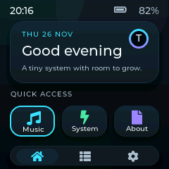 | 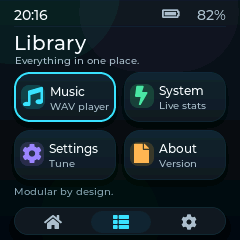 | 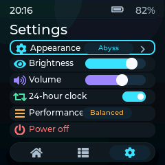 |
| **Music** | **System** | **About** |
| 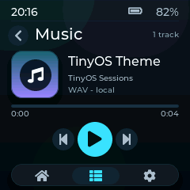 | 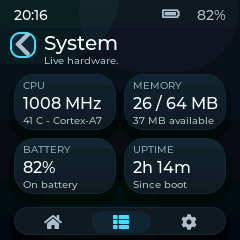 | 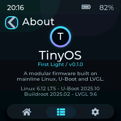 |

| Personalisation | | | |
|:---:|:---:|:---:|:---:|
| 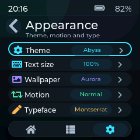 | 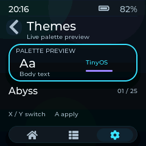 | 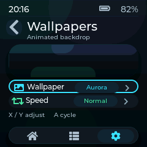 | 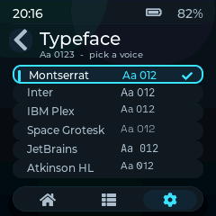 |
| **Appearance** | **25 themes** | **10 wallpapers** | **6 typefaces** |

| Text scale 115 % | Text scale 130 % |
|:---:|:---:|
| 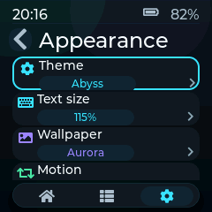 | 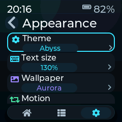 |
| **Appearance 115 %** | **Appearance 130 %** |

| Empty | Loading | Error |
|:---:|:---:|:---:|
| 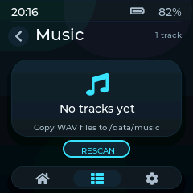 | 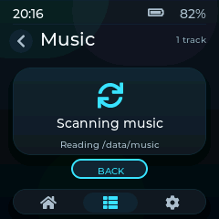 | 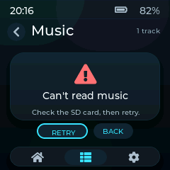 |
| **Empty** | **Loading** | **Error** |

## What it is

- A custom **LVGL 9.6** shell with **25 runtime palettes**, **10 animated
  wallpapers**, **6 typefaces at 8–28 px**, **three text scales (100/115/130 %)**,
  animated screen transitions and a focus ring designed for physical buttons.
  Every palette is contrast-checked and no text is smaller than 10 px. Text
  scaling recomposes rows and scrolls lists; it never bitmap-scales the UI.
- **Empty, loading and error states** for music, each with a visible, reachable
  Retry/Back action, plus a one-shot input policy: held A triggers once, D-pad
  repeat is cancelable and never queues focus animations.
- A **Linux 6.12 LTS** firmware built with **Buildroot 2025.02.3**, **musl** and
  **BusyBox**; the kernel boots from a plain ext4 root filesystem.
- A modern **U-Boot 2025.10** boot chain with a reproducible SD-card image.
- Ten independent modules — Home, Library, Settings, Music, System, About,
  Appearance, Themes, Wallpapers and Typeface — sharing one focus model, a
  runtime palette engine and a compact widget toolkit.
- Native fbdev output through the mainline **panel-mipi-dbi-spi** driver, evdev
  input through the pcal6416 expander, AXP209 battery telemetry and an
  ALSA-based WAV player.

## Stack

| Layer | Choice |
|---|---|
| SoC | Allwinner V3s, Cortex-A7, 64 MB DDR2 |
| Bootloader | U-Boot 2025.10 with upstream RG Nano device tree |
| Kernel | Linux 6.12.115 LTS, `sunxi_defconfig` + TinyOS fragment |
| Userland | Buildroot 2025.02.3, musl, BusyBox |
| UI | LVGL 9.6, custom theme and widgets |
| Audio | ALSA, PCM16 WAV playback |
| Image | MBR SD image: U-Boot, FAT boot, ext4 root, FAT data |

The design rationale and upstream sources are in [docs/RESEARCH.md](docs/RESEARCH.md).

## Quick start (simulator)

The host simulator builds the complete UI without a device and writes real
240 × 240 PNG frames:

```sh
make sim
./build/tinyos-sim --screen home --out build/home.png
./build/tinyos-sim --screen settings --out build/settings.png
./build/tinyos-sim --screen appearance --theme 14 --font 2 --out build/paper-plex.png
```

`--theme` accepts `0…24`, `--font` accepts `0…5` and `--wallpaper` accepts
`0…9`. The numbered order is also the order shown in the on-device pickers.
`--frames N` stops after N 16 ms frames (default 90), so a single frame in
the middle of an entrance, dialog or value animation can be inspected.

Text scale, states and the input policy can be exercised without a device:

```sh
./build/tinyos-sim --screen settings --text 130 --down 5 --out build/power-off.png
./build/tinyos-sim --screen music --state loading --text 115 --out build/loading.png
./build/tinyos-sim --keytest --screen home
```

`--text` accepts `100`, `115` and `130`; `--state` accepts `empty`, `loading`
and `error`; `--down N` presses Down through the real host key path, and
`--keytest` prints the held-A / held-D-pad event counts.

Render every screen into `docs/`:

```sh
make shots
```

The simulator uses only the shared application code, LVGL and the host platform
shim. It is the fastest way to iterate on layout, typography and focus order.

## Build the firmware

The complete image is built on Linux with Buildroot. The repository ships the
external tree, U-Boot fragment, kernel fragment, panel firmware and image layout:

```sh
sh scripts/build-image.sh
```

Result:

```text
output/images/tinyos-rg-nano.img
```

The script downloads Buildroot 2025.02.3, verifies its SHA-256, configures the
`tinyos_rg_nano_defconfig` and builds Linux, U-Boot, the root filesystem and the
SD image. CI performs the same build and uploads a compressed image plus its
SHA-256 checksum. More details, host packages and troubleshooting are in
[docs/BUILD.md](docs/BUILD.md).

## Flash and boot

> **Warning:** write the image to the correct block device. `lsblk` is your
> friend; an incorrect `of=` destroys data.

```sh
xz -dk tinyos-rg-nano.img.xz
sudo dd if=tinyos-rg-nano.img of=/dev/sdX bs=4M conv=fsync status=progress
sync
```

Insert the card into the RG Nano and power it on. The boot chain is:

```text
BootROM → SPL → U-Boot → boot.scr → zImage + DTB → Linux → BusyBox init → tinyos
```

A rescue shell is available on the USB serial console at **115200 8N1**
(`ttyS0`). The UI is restarted automatically if it exits.

## Controls

| Button | Action |
|---|---|
| D-pad | Move focus spatially; repeat after 350 ms, then every 90 ms |
| A | Open / activate (one-shot, even when held) |
| B | Back |
| X / Y or L / R | Previous/next track, preview theme, adjust wallpaper or slider |
| Start | Home |
| Select | Back |
| Power | Short press: back; long press: AXP209 shutdown |

The mapping is implemented in `src/platform/linux/input_evdev.c` and can be
adjusted without touching the UI.

## Project layout

```text
src/
  app.c, main.c        application lifecycle and main loop
  core/                settings, logging, file helpers, audio API
  ui/                  palette engine, widgets, shell, fonts and wallpapers
  ui/fonts/            generated static LVGL bitmaps (five families × eight sizes)
  modules/             home, apps, settings, music, system, about, appearance,
                       themes, wallpapers, typeface
  platform/host/       simulator display, input, power and audio shims
  platform/linux/      fbdev, evdev, AXP209/sysfs and ALSA backends
sim/                   host renderer and PNG writer
config/lv_conf.h       generated LVGL 9.6 configuration
buildroot-external/    Buildroot tree, board files, kernel/U-Boot fragments
tools/                 LVGL build helper and panel-firmware converter
docs/                  design, hardware, build and UI documentation
```

See [docs/ARCHITECTURE.md](docs/ARCHITECTURE.md) for the layer model and
[docs/MODULES.md](docs/MODULES.md) for the module contract.

## Status

- **Simulator:** builds and renders all ten screens at 100/115/130 %; it also
  captures empty/loading/error states and prints the input-repeat test.
- **Text scale:** verified at 100/115/130 % with focused, scrolled lists and no
  clipping on the 240 px canvas; screenshots are in [docs/UI.md](docs/UI.md).
- **Input:** held A is one-shot and D-pad repeat is cancelable; the simulator
  test passes. Real button feel and repeat tempo remain hardware checks.
- **ARM compile check:** all shared sources plus fbdev/evdev/AXP209/ALSA
  backends compile for `arm-linux-musleabihf` with Zig and the ALSA headers.
- **Full image:** built by the GitHub Actions workflow from the Buildroot
  external tree.
- **Hardware:** not yet validated on a physical RG Nano. Panel init sequence,
  button mapping, backlight scaling and audio routing are the first things to
  verify on device. See [docs/HARDWARE.md](docs/HARDWARE.md) for the known
  unknowns.

## Documentation

- [Research and technology choices](docs/RESEARCH.md)
- [Architecture](docs/ARCHITECTURE.md)
- [Hardware notes](docs/HARDWARE.md)
- [Building and flashing](docs/BUILD.md)
- [Module contract](docs/MODULES.md)
- [UI and design system](docs/UI.md)
- [Roadmap](docs/ROADMAP.md)
- [Third-party notices](docs/THIRD_PARTY.md)

## License

TinyOS original code is released under the **MIT License**. Upstream components
keep their own licenses; see [docs/THIRD_PARTY.md](docs/THIRD_PARTY.md).
