# UI and design system

## Intent

TinyOS should feel like a small, deliberate device — not a desktop shrunk onto a
240 px screen. The interface has one focus, one obvious primary action and a
calm surface hierarchy. Personalisation is a first-class feature: 25 palettes,
10 animated wallpapers and 6 typefaces can be changed without leaving the
device.

The canvas is always **240 × 240** and is drawn at native resolution, never
through an intermediate buffer. The optional **100 / 115 / 130 % text scale**
changes the font ramp and recomposes the affected rows; it never upscales
bitmaps or the canvas. Icons, hairlines and focus rings stay pixel-aligned.

## Canvas

| Property | Value |
|---|---|
| Resolution | 240 × 240 |
| Status line | y = 0…26 |
| Content | y = 30…204 (174 px high) |
| Navigation | y = 207…235 |
| Safe margin | 14 px left/right |
| Corner radius | 10–20 px |
| Border | 1 px, low-opacity line colour |

Every screen builds inside the 174 px content viewport. New screens must not
add a fourth shell layer or draw over the status/navigation bars.

## Colour roles

Colours are **runtime tokens**, not compile-time constants. `tinyos_theme_apply()`
switches the active palette, refreshes the shared styles and the shell rebuilds
its background. Modules use semantic roles only:

| Token | Role |
|---|---|
| `BG` | deepest background |
| `BG_2` | background gradient top / navigation base |
| `SURFACE` | cards and rows |
| `SURFACE_2` | raised surfaces, selected rows, pills |
| `LINE` | hairlines and borders |
| `TEXT` | primary text |
| `MUTED` | secondary text |
| `DIM` | metadata and hints |
| `CYAN` / accent | focus, active navigation, primary action |
| `CYAN_DEEP` | gradient partner for artwork |
| `VIOLET` / accent 2 | media and secondary highlights |
| `GREEN` | positive state |
| `AMBER` | attention / settings |
| `RED` | destructive actions |
| `ON_ACCENT` | text/icon colour on an accent fill |

### The 25 palettes

`Abyss`, `Aurora`, `Ember`, `Rosewood`, `Cobalt`, `Lavender`, `Forest`,
`Sandstone`, `Nord`, `Gruvbox`, `Dracula`, `Tokyo Night`, `Solarized`,
`Monochrome`, `Paper`, `Porcelain`, `Mint Light`, `Solar Flare`, `Cyberpunk`,
`Vaporwave`, `Terminal`, `Amber CRT`, `Ice`, `Cosmos`, `Candy`.

Nineteen are dark (including the strictly monochrome palette); `Paper`,
`Porcelain`, `Mint Light` and `Solar Flare` are light. Every foreground/background
pair used for text, metadata, icons and buttons is checked for at least
**4.5:1** contrast on both `SURFACE` and `SURFACE_2`. `ON_ACCENT` is checked
against the accent fill.

Theme preview is a live miniature: it updates its gradient, sample cards, text
and accent bar as the user steps through the gallery. Applying a theme rebuilds
the shell once, so no old colours or fonts remain behind.

## Typography

Six families, each converted to static 4-bpp LVGL bitmaps at **8, 10, 12, 14,
16, 20, 24 and 28 px**:

| Family | Character |
|---|---|
| Montserrat | default; geometric and friendly |
| Inter | neutral, compact UI text |
| IBM Plex Sans | technical, slightly narrow |
| Space Grotesk | expressive display text |
| JetBrains Mono | coding / high-contrast monospaced |
| Atkinson Hyperlegible | maximum character differentiation |

Only printable ASCII (`U+0020`–`U+007E`) is generated for the five custom
families. All symbols and icons always use LVGL's built-in Montserrat, so a
typeface change can never remove a battery, arrow or navigation glyph.

Default sizes:

| Size | Use |
|---|---|
| 28 | splash orb |
| 24 | about wordmark |
| 20 | screen titles, greeting |
| 16 | player title, metric values |
| 14 | status time and battery percentage, empty-state title, dense numerals |
| 12 | row titles, card titles |
| 10 | labels, values, hints, metadata |

No text is smaller than 10 px at 100 % (12/14 px at 115/130 %). All fixed
interface labels were rendered at all three scales and fit their rows; only a
dynamic media title can still end in `LV_LABEL_LONG_MODE_DOTS`. Deliberate
multi-line copy opts into wrapping. Typeface and text-scale changes rebuild the
shell and are stored in `/data/tinyos/settings.ini`.

## Text scale

**Appearance → Text size** cycles **100 → 115 → 130 %** and saves immediately.
The setting is a type ramp plus a layout variant, not a transform: rows grow,
secondary copy yields space, and long lists scroll instead of clipping.

| Base role | 100 % | 115 % | 130 % |
|---|---:|---:|---:|
| labels, hints, metadata | 10 | 12 | 14 |
| row / card titles | 12 | 14 | 16 |
| dense numerals | 14 | 16 | 20 |
| player title, metric values | 16 | 20 | 20 |
| screen titles, greeting | 20 | 24 | 24 |
| wordmark | 24 | 24 | 24 |
| splash | 28 | 28 | 28 |

The status time and battery percentage follow the dense-numeral ramp; the
58 px time box still fits at 20 px. Typeface specimens deliberately use a
smaller specimen ramp (12 px at 100 %, 12/14 px at 115/130 %).

Large-text composition:

- Headings keep a 24 px cap; secondary header taglines are hidden above 100 %.
- **Settings**, **Appearance** and **Wallpapers** switch to 38 px two-line rows:
  label on line 1, slider/pill/switch on line 2. The 6 Settings rows, 5
  Appearance rows and 6 Typeface rows scroll; focus is always scrolled into view.
- **Home** grows the hero to 96 px and drops the decorative orb at 115/130 %.
- **Library** uses 56 px cards, 14 px titles and shorter subtitles; its footer
  and page subtitle are hidden above 100 %.
- **Music** uses a 52 px album card, a 154 px title column at 20 px, and a 46 px
  play button at 115/130 %.
- **System** cards grow to 60 px and values to 20 px; the secondary notes are
  hidden. **About** shortens its mission copy and hides the upstream credit
  block. **Themes** grows its preview to 74 px. **Wallpapers** uses a 50 px
  preview and 38 px rows. The power-off dialog grows from 180 × 108 to
  212 × 124 px with 88/100 px buttons.

Evidence: the five critical screens at all three levels, plus focus and scroll
proof at 130 %:

| Screen | 100 % | 115 % | 130 % |
|:---:|:---:|:---:|:---:|
| Settings | 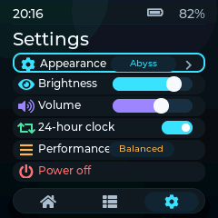 | 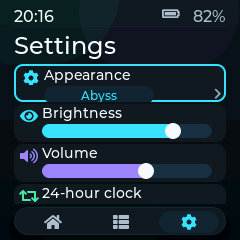 | 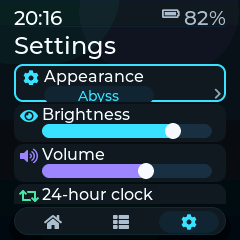 |
| Appearance | 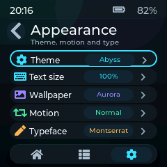 | 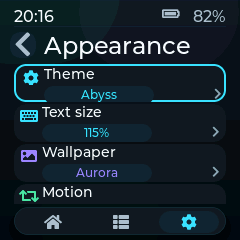 | 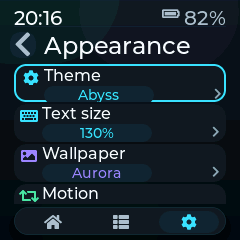 |
| Typeface | 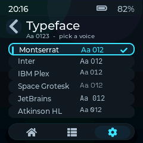 | 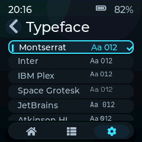 | 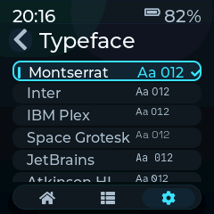 |
| Music | 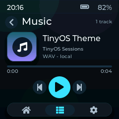 | 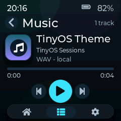 | 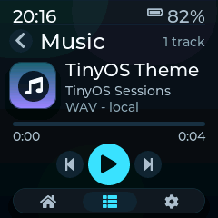 |
| Themes | 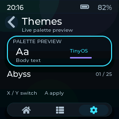 | 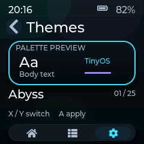 | 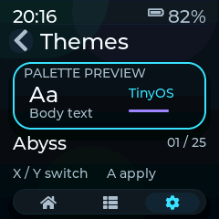 |

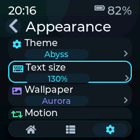
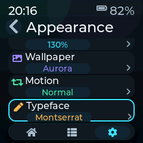
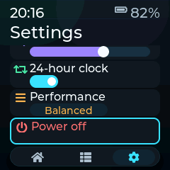
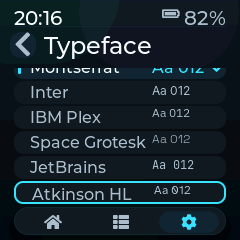

## Screen patterns

### Home

At 100 %: a 212 × 88 hero card with the date, greeting, one-line tagline and a
gradient orb. Three 64 × 44 quick tiles (Music, System, About) sit below a
“QUICK ACCESS” eyebrow — only destinations the tab bar cannot reach. At
115/130 % the hero grows to 96 px and the decorative orb is omitted so
“Good evening” keeps a 196 px line; the tiles move to y = 124. The wallpaper
remains visible around the cards but never behind body text without a solid
surface.

### Library

A 2 × 2 grid of 102 × 50 app tiles at y = 42 and y = 100 (8 px gutter) with a
24 px badge, 12 px title and 10 px subtitle. At 115/130 % the tiles are 56 px
tall at y = 40/104, the titles use the 10→12/14 px ramp, and the subtitle is
shortened (“WAVs”). The page subtitle and “Modular by design.” footer are
secondary and hidden above 100 % so the grid stays inside the 174 px content
viewport. The focused tile gets a 2 px accent ring. Tiles carry no chevrons;
the whole card is the target.

### Settings

At 100 %: six compact 22 px rows with 2 px gaps and a 9 px radius, starting at
y = 28: **Appearance**, Brightness, Volume, 24-hour clock, Performance and Power
off. Sliders, switches and pills share a 198 px right edge; slider tracks are
88 px wide at x = 110. Sliders and the clock switch focus their whole row, so
the focus ring never crosses a knob. The theme pill uses the compact theme name
(for example “Mono” for Monochrome) and never ellipsises.

At 115/130 % the list starts at y = 34 and every row becomes a **38 px two-line
row**: icon and 14/16 px label on line 1, a 170 px slider or a 110 × 18 px pill
on line 2. Six rows exceed the viewport, so the list scrolls and focus-in-view
brings the active row into view; the focus policy stays inside the list until
its last row before reaching the tab bar. The dialog grows from 180 × 108 at
(30, 62) to 212 × 124 at (14, 58), with 88/100 px buttons, a 16/20 px title and a
12/14 px body (“TinyOS will shut down.”). It owns the modal group; B closes it and
returns the ring to Power off. Appearance is always the first row so
personalisation is discoverable.

### Appearance

At 100 %: five 24 px rows with 2 px gaps: Theme, **Text size**, Wallpaper,
Motion and Typeface. Each row shows its current value in a 72 × 18 pill and a
12 px chevron at x = 186. Text size cycles 100 → 115 → 130 % and reloads the
shell; the 5 rows fit the 132 px list and the old footer hint is gone.
Theme and typeface pills use the compact names (“Mono”, “Grotesk”).

At 115/130 % the header tagline is hidden and the same five rows become 38 px
two-line rows with a 110 × 18 px pill; the list starts at y = 34 and scrolls.
The Text size row stays second, so its current percentage is visible at every
scale. A back button sits at the top left; A opens the picker or cycles the
text size, B returns to Settings.

### Themes

A live 212 × 62 preview card at y = 42 at 100 %; at 115/130 % it grows to 74 px
at y = 38 with a 50 px sample block. The page tagline is hidden above 100 %.
Palette name, `NN / 25` counter and the X/Y hint remain inside the viewport.
X/Y or L/R steps through the gallery; A applies immediately and rebuilds the
UI. The preview never uses the old palette for its sample cards.

### Wallpapers

A 212 × 54 animated preview at y = 42 above two 22 px rows at y = 100 and
y = 124 at 100 %: Wallpaper and Speed, each with a 72 × 18 pill at x = 106. The
hint line sits at y = 152. Motion lives in Appearance.

At 115/130 % the tagline and hint are hidden, the preview is 50 px at y = 36,
and the two rows are 38 px two-line rows at y = 94/134 with 110 × 18 px pills.
Style and speed cycle on A; X/Y or L/R adjusts the focused row. Changes are
saved and applied to the shell wallpaper immediately, so the preview and the
real background never drift apart.

### Typeface

Six 21 px rows at 100 %; 23 px rows with 2 px gaps in a 136 px scroll list at
115/130 %. Each row renders its name with the title ramp (12→14/16 px) and
`Aa 012` in the candidate family at 12/12/14 px, with a selected marker and
check. The last row is reached by scrolling; focus-in-view keeps the ring fully
visible. A applies the family and rebuilds the shell.

### Music

At 100 %: a 60 px album card at (14, 34), vinyl disc, 16 px title at (86, 38),
10 px artist at y = 63 and 10 px format at y = 78, progress bar at y = 102,
elapsed and total time, and three transport buttons. The title is one line in
`LV_LABEL_LONG_MODE_DOTS`, so only an unusually long file name ends in an
ellipsis; all fixed interface labels fit without one. Play is 44 px with a
flat fill; previous/next are 28 px with **6 px gaps** (no overlapping hit
areas). X/Y or L/R changes track without moving focus. A 700 ms timer updates
the position only while the screen exists.

At 115/130 % the art is 52 px, the title column is 154 px at 20 px, the artist
and format use 12/14 px, the progress bar is 5 px and the play button grows to
46 px. “TinyOS Theme” fits the wider column without an ellipsis.

### Empty, loading, error

Music is the only data-backed screen. All three states use a 212 × 96 gradient
card at y = 40/44 and put the first focus on an action, never on an icon or a
spinner:

- **Empty** — no tracks. A 36 px audio glyph, “No tracks yet”, the
  `/data/music` path and a focused RESCAN pill. RESCAN enters Loading.
- **Loading** — a pending rescan. A static refresh glyph, “Scanning music” and
  “Reading /data/music”; a focused BACK pill is available while a one-shot
  320 ms timer runs the synchronous scan. The forced screenshot uses the same
  state without the timer.
- **Error** — the audio backend failed to initialise. A warning glyph, “Can't
  read music”, “Check the SD card.” and focused RETRY plus BACK buttons. RETRY
  recreates the ALSA backend through `tinyos_audio_create()` and rescans; if
  that fails the error stays. B returns.

Every state is reachable through the real module and has a visible 2 px focus
ring; `--state empty|loading|error` only forces a state for deterministic
screenshots.

| Empty | Loading | Error |
|:---:|:---:|:---:|
| 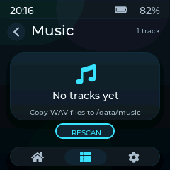 | 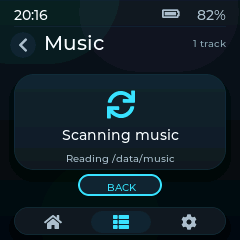 | 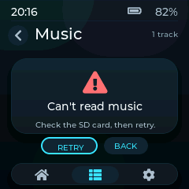 |

### System

Four 102 × 56 metric cards at 100 %: CPU, memory, battery and uptime, each
with a 10 px label, 16 px value and 10 px note. At 115/130 % the cards grow to
60 px at y = 40/108, the labels use 12/14 px, the values 16/20 px and the
secondary notes are hidden; “1008 MHz” and “26/64 MB” fit the widened 96 px value box. A
back button completes the screen.

### About

At 100 %: centered 42 px orb, 24 px wordmark, codename/version, mission
statement and a two-line component credit. Back is the only control. At
115/130 % the orb moves down, the copy is shortened to “Modular firmware on /
Linux, U-Boot and LVGL.” and the upstream credit block is hidden so the content
stays inside 174 px.

## Focus and controls

The RG Nano mapping is:

| Button | Action |
|---|---|
| D-pad | move focus spatially |
| A | open / activate / cycle |
| B or Select | back |
| Start | Home |
| X / Y or L / R | previous/next track, preview theme, adjust wallpaper or slider |

Every interactive object is clickable, joins the current `lv_group` and gets a
2 px accent focus ring. Rows that contain a single control (Appearance,
sliders, clock, Performance, media transport, navigation) take the ring, so it
is never clipped by a knob or a background element. A 90 ms style transition
fades the ring and the pressed fill; nothing moves.

### Input policy

`src/core/key_repeat.c` is shared by the evdev backend and the host shim:

- A, B, Start, Select and prev/next are **one-shot**: a physical hold emits one
  event. Kernel repeat events (`value == 2`) are ignored.
- Directions repeat after **350 ms**, then every **90 ms**. Releasing the key
  cancels the next repeat immediately, and a non-direction press stops the
  current direction repeat.
- `poll()` returns at most one key per frame and advances the deadline from the
  current time, so a slow frame produces one move, never a burst or a queued
  chain of focus animations.
- The simulator's `--keytest` drives the real host indev: a held A produced
  **1 CLICKED / 1 event**; a held D-pad produced **3 events in 480 ms** and
  **0 after release**. `--down N` uses the same path for the scroll/focus
  evidence screenshots.

- A scrollable list scrolls the newly focused row into view. Rows clipped below
  the list viewport remain focus candidates, and while a list is focused the
  next row wins over the tab bar; the list is exhausted first.
- The power-off dialog owns a **separate group**: the D-pad cannot reach the
  screen behind it, B closes the dialog and focus returns to the Power off row.
  Start closes the dialog before going Home.
- The selected tab stays lit on detail screens: Settings stays active on
  Appearance, Themes, Wallpapers and Typeface, Library stays active on Music,
  System and About. Selected (filled pill) and focused (outline) are distinct
  treatments. The shell maintains a **back stack** for nested screens:
Settings → Appearance → Themes → B returns to Appearance, then Settings, then
Home. Changing tabs clears the stack.

## Motion

Motion confirms a state change; it never delays input or moves the layout.

| Event | Duration | Easing |
|---|---|---|
| Focus / press ring and fill | 90 ms | ease-out |
| Screen entry | 200 ms fade + 10 px slide | ease-out |
| Card reveal | 260–300 ms, 40 ms stagger | ease-out |
| Dialog entry | 150 ms fade + 8 px rise | ease-out |
| Theme step (inner samples) | 140 ms, 5 px settle | ease-out |
| Slider value | 90 ms | ease-out |
| Music progress | 450 ms | bar animation |

- Focus changes cross-fade the ring colour; the ring never travels across the
  screen and never bounces.
- Pressed is a separate state: a 2 px primary-colour ring over the focused ring,
  so a held A never hides where the user is.
- The dialog slides and fades in as one card (180 × 108 at 100 %, 212 × 124
  at 115/130 %); the backdrop itself is static, avoiding a full-screen redraw.
- Text scaling is a build-time font/layout change, not a per-frame transform.
  Reduce Motion is frame-identical at 100 % and 130 % (content compared below
  the status line).
- The palette preview keeps its card on the grid; only the two samples inside
  move 5 px when stepping.
- Wallpapers: slow ping-pong translations, opacity breathing and ring scaling.
- Speed: Still, Slow, Normal, Fast. **Reduce motion** forces Still and disables
  content reveals, the dialog rise, nudges, slider and progress animation; focus
  colours still change, just without movement.
- Animations are stopped when their objects are deleted; no global animation
  timer and no full-screen effects.

## Contrast and legibility

- Primary text: at least 4.5:1 on every surface; most palettes exceed 7:1.
- Metadata and dim hints: at least 4.5:1.
- Accent icons and text: at least 4.5:1.
- Destructive red: at least 4.5:1.
- No text directly on a moving wallpaper; cards use opaque or near-opaque
  surfaces.
- The status line carries a 14 px time at 100 % (16/20 px at 115/130 %), a
  14 px battery icon at (162, 6) and a 14/16/20 px percentage, split into
  separate labels so a typeface without symbol glyphs cannot hide battery
  state. The 58 px time box fits the 20 px clock. There is no second wordmark.

## Performance rules

- Native 240 × 240 rendering; partial refresh only; `LV_DEF_REFR_PERIOD` is
  16 ms (60 Hz) with partial draw buffers. Text scales resolve to existing
  static fonts at build time; no runtime rasterisation, transform or second
  draw pass.
- Static font bitmaps, no runtime font loading or rasterisation.
- No large shadows on moving controls; the transport play button is a flat
  accent fill.
- Host-simulator check, 300 frames per run: 35 ms with Aurora, 60 ms with
  Ripple, 19 ms with Reduce Motion (relative host cost, not device FPS).
- One wallpaper layer behind status/content/navigation; child shapes are clipped.
- The wallpaper uses a small, fixed number of LVGL objects and stores its
  animation handles so they can be stopped explicitly on deletion.
- One status timer and at most one module timer; both die with the screen.
- No blur, no full-screen shadow stacks, no runtime image decoding for chrome.

## Verification of this round

- **Clean build:** `make clean` followed by the full `sim` build → **0 warnings,
  0 errors**.
- **Two full render passes:** all ten screens at 100 % were rendered twice and
  compared pixel-by-pixel; the result is **byte-identical**, including the
  status clock. `docs/ui-*.png` is byte-identical to the second pass.
- **Entrance animation:** Home at frame 3 vs. frame 90 differs in the content
  viewport (30,284 px at 100 %; 32,321 px at 130 %).
- **Reduce Motion:** frame 3 vs. frame 90 is **0 differing pixels** below the
  status line at both 100 % and 130 %.
- **Input:** `--keytest` → held A **1 CLICKED / 1 event**, D-pad **3 events in
  480 ms**, **0 events after release**.
- **Text scale:** Settings, Appearance, Typeface, Music and Themes were rendered
  at 100/115/130 % and inspected at 2×; the 130 % focus/scroll shots (Settings
  Power off, Appearance Typeface, Typeface Atkinson) confirm the focused row is
  fully visible. Dialog:

| Dialog 100 % | Dialog 115 % | Dialog 130 % |
|:---:|:---:|:---:|
| 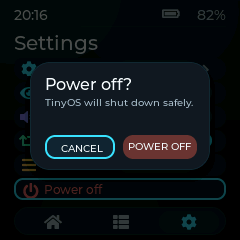 | 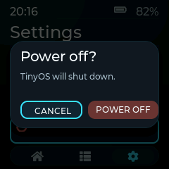 | 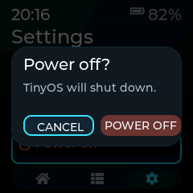 |

**Not verified here:** physical button feel, the final repeat tempo on the
pcal6416 expander and the panel's real refresh behaviour. Those need the RG
Nano hardware; the simulator proves logic, layout and focus, not haptics or
panel FPS. The host performance numbers above are relative host costs, not a
device framerate claim.
